Our three-day, two-night hike up Mount Pulag via the Akiki Trail was a beautiful experience. The weather was great: chilly, but not too chilly, which made for a comfortable (if tiring) climb.

Pulag offers three biomes in one hike. Over the three days, we walked through pine forest, mossy forest, and open grasslands at the top.

## The pine forest

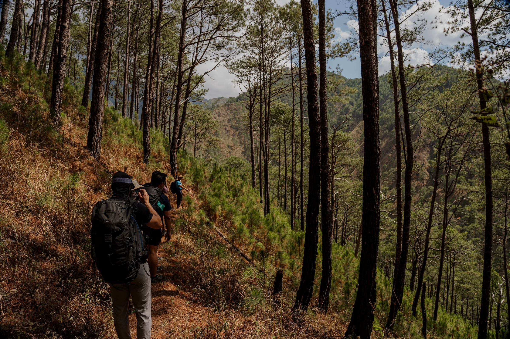

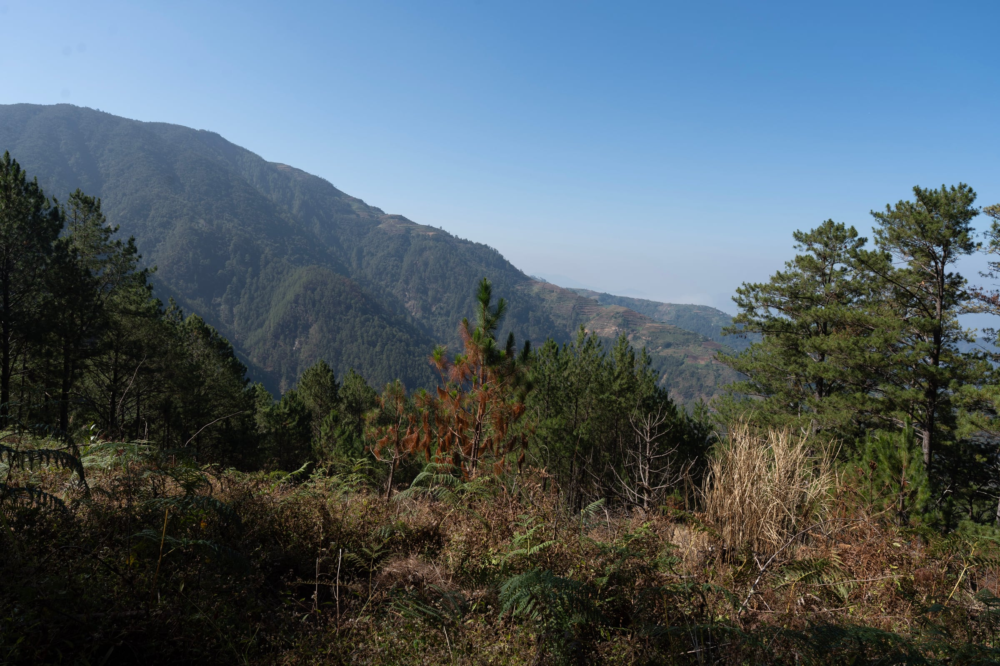

## The mossy forest

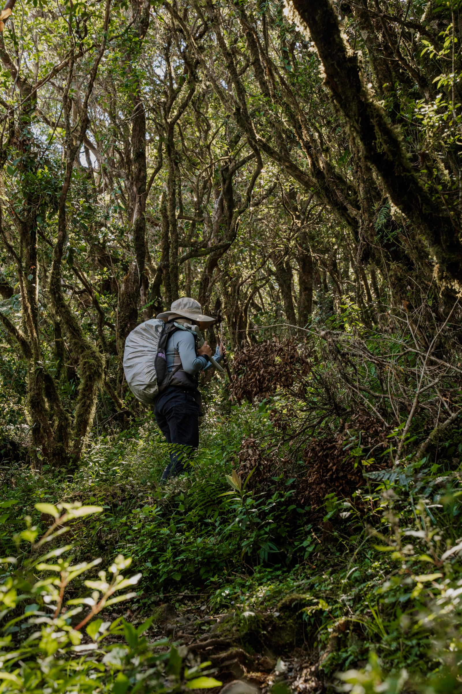

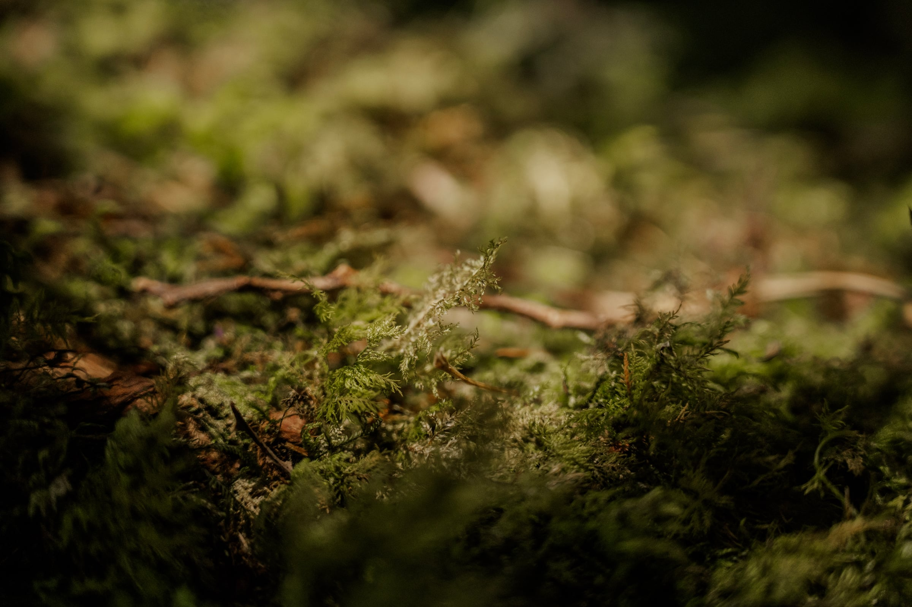

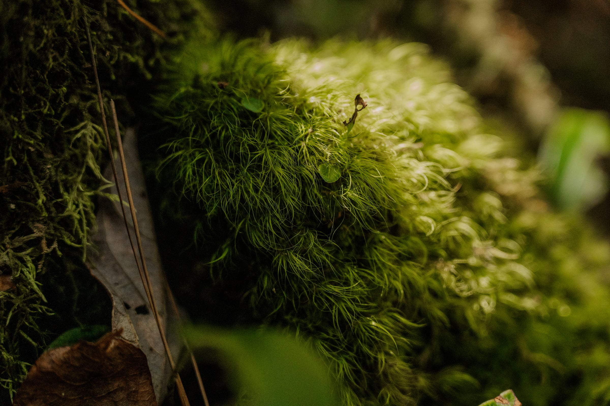

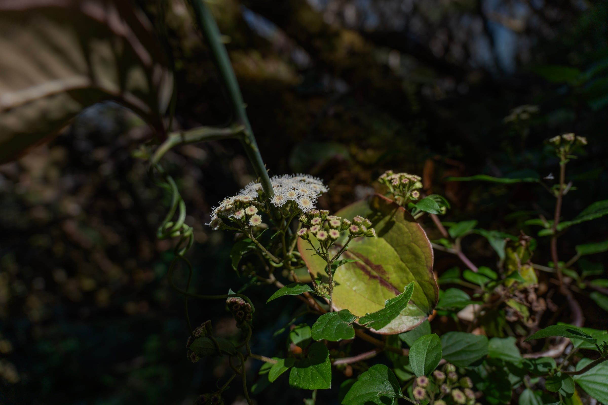

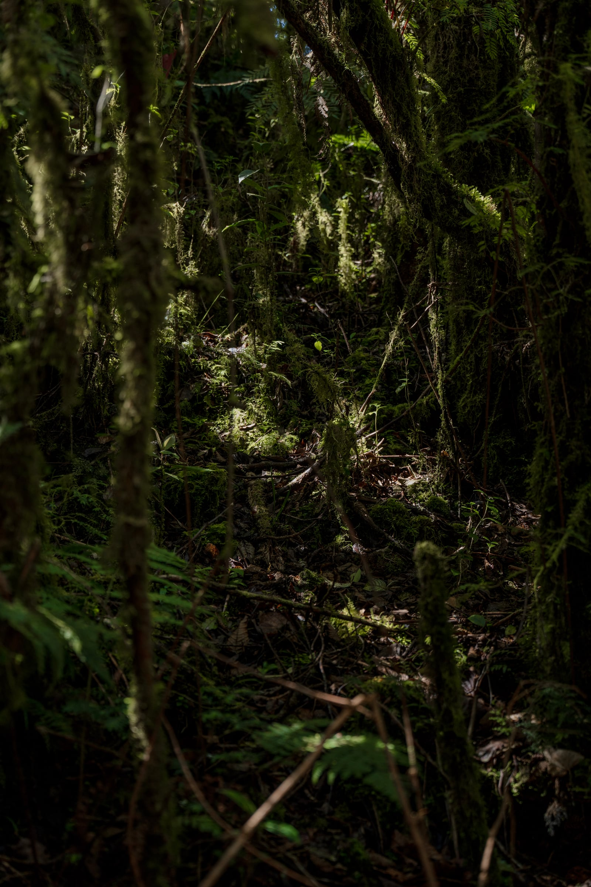

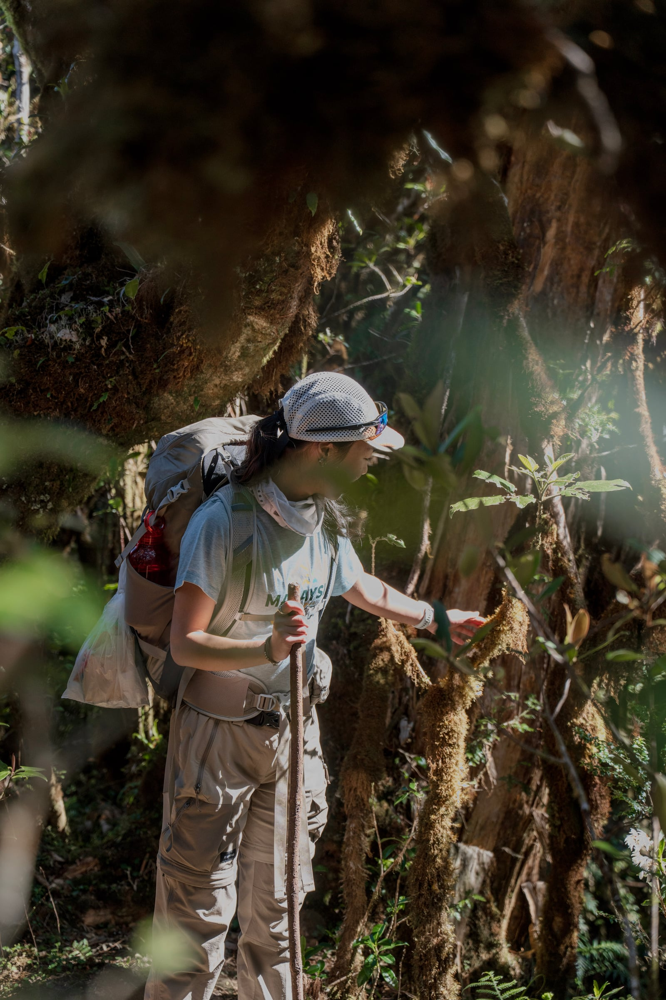

## The grasslands

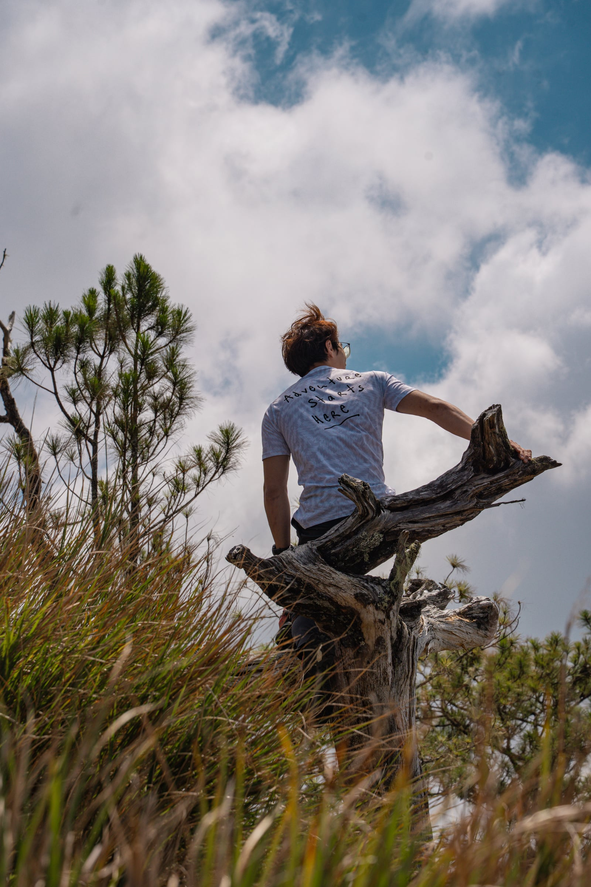

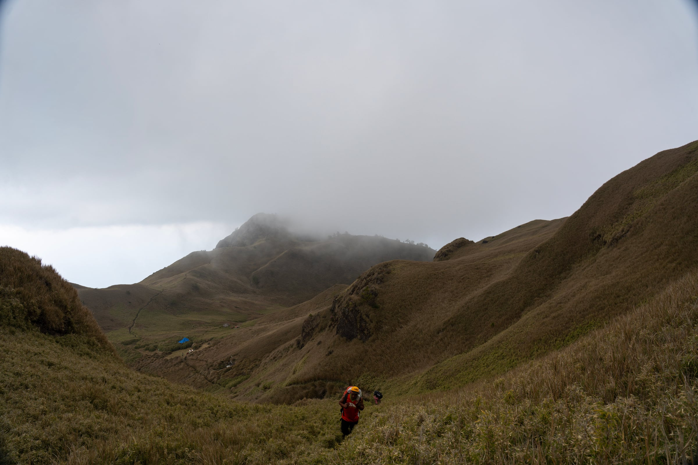

## Nights under the stars

Camping in the mountains, the nights were amazing. It was a new moon, so we could see the Milky Way and a sky full of stars.

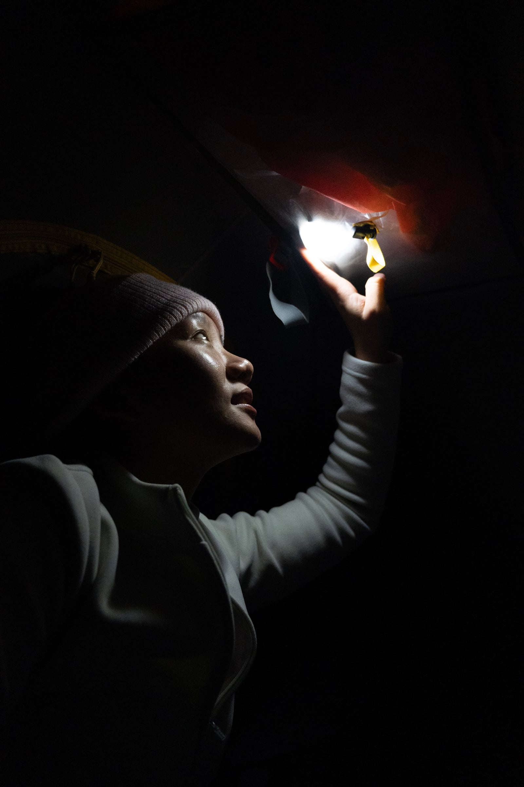

## Bringing the camera along

This was the first time I brought my camera on a hike, and it was well worth it. Hiking with it hanging around my neck was a first too. Next time, I'll get a shoulder-strap attachment.

## Worth every step

Definitely not a beginner hike, but one that is well worth it!
