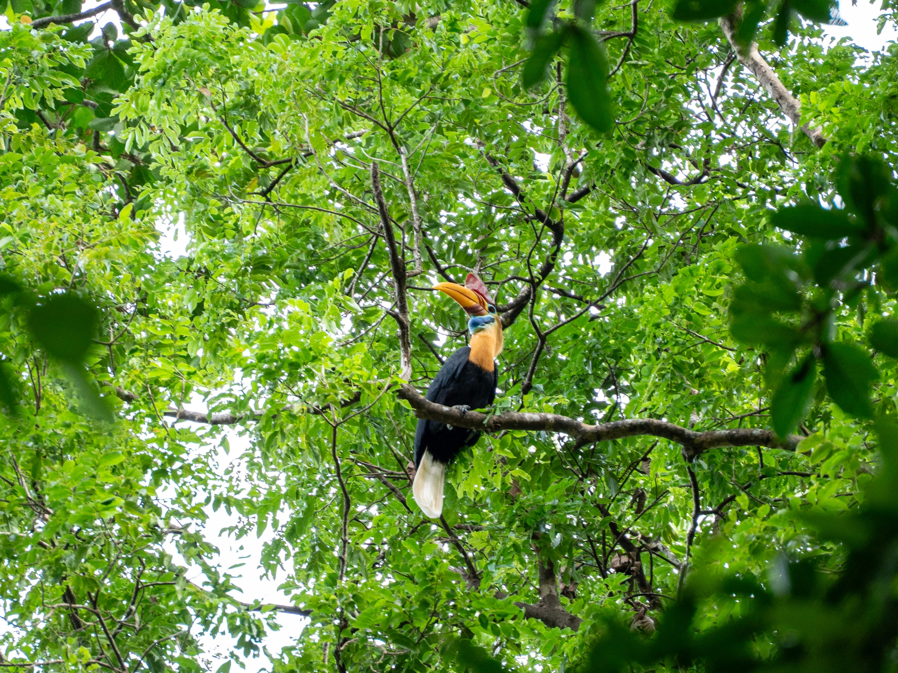
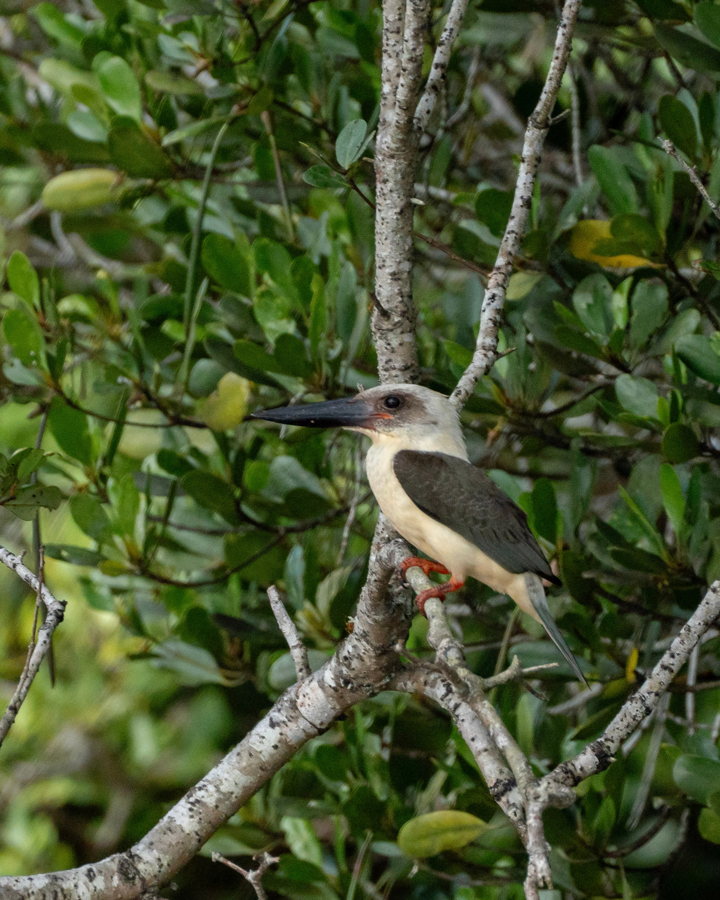

<!--
  DRAFT. The facts below (dates, species, settings) come from your photos.
  Everything in [square brackets] is a prompt for your own memories. Rewrite or
  delete it, because only you know what actually happened out there.
-->

Tangkoko sits on the northern tip of Sulawesi, on the far side of the Wallace Line. That invisible boundary splits the wildlife of Asia from that of Australasia, and Sulawesi falls in between. Many of its animals evolved in isolation, and they look it.

I had two days there, and they turned into a kingfisher weekend. I photographed four kingfisher species, plus a Knobbed Hornbill. All five are found only in Sulawesi and the islands around it.

[Why Tangkoko? How you got there (the drive from Manado or Bitung), who you went with, and what you were hoping to see.]

## Day 1: The forest floor

The first bird I photographed was a **Green-backed Kingfisher**, a forest kingfisher that hunts on the ground rather than over water. Under the canopy there was almost no light. One frame needed ISO 51200 at 1/200s, and it was still worth taking.

[What was it doing? How close did you get? Did a guide know where it would be?]

Later that day, a **Lilac Kingfisher** sat on a bare branch long enough for three frames. [Describe the moment: how you spotted it, how long it stayed, what it sounded like.]

High above, a **Knobbed Hornbill** sat in the canopy with its huge, bright casque. [Did you hear it before you saw it? Hornbill wingbeats are famously loud.]

## Day 2: The big bill and the tiny one

Day two brought the **Great-billed Kingfisher**: a pale head, dark wings and an enormous black bill. I caught one in flight against the rocks at 1/3200s. [Where was this? Along the shore, a river mouth, a mangrove?]

Then came the smallest of the four: the **Sulawesi Dwarf Kingfisher**, a tiny orange bird half-hidden among the leaves. [Where was it, and how did you spot something that small?]

A **Brahminy Kite** circled overhead too, one of the few birds that looked like home.

## What I'd tell someone going

- [Best time of day]
- [Whether you'd hire a local guide, and who]
- **Light:** the forest floor is very dark, so be ready to push your ISO hard (I went to 51200).
- **Lens:** everything here was shot on the Tamron 70–300mm. [Did you wish you'd had more reach?]

## Also seen

[Anything you saw but didn't photograph, such as tarsiers or crested black macaques? List them here, or delete this section. The species you photographed are listed automatically at the bottom of the page.]
