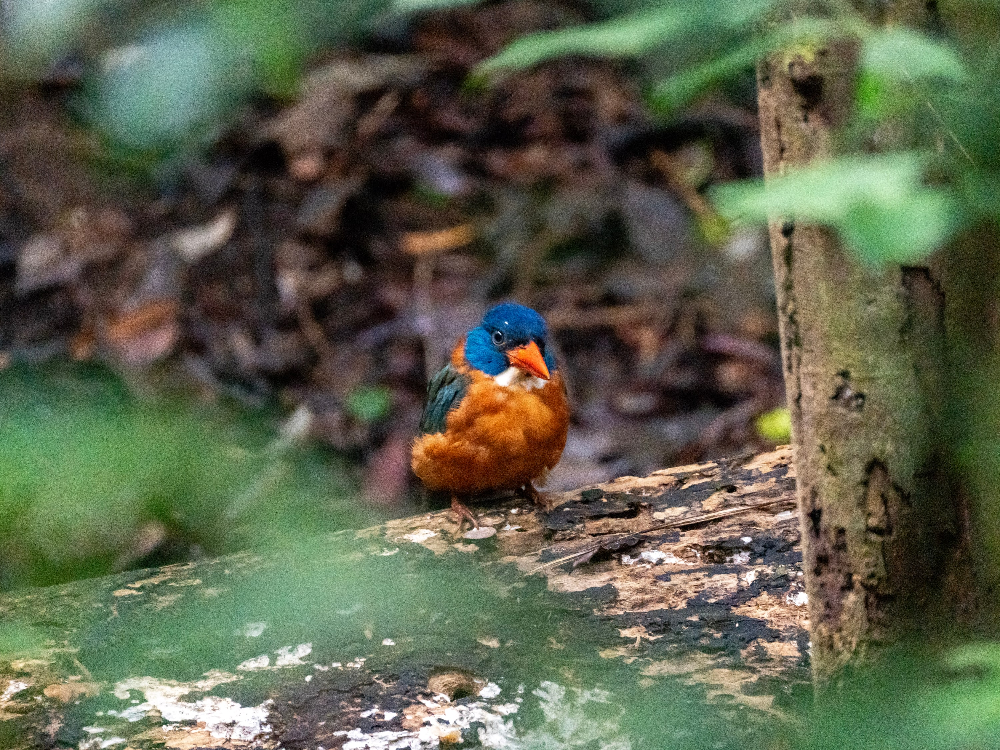
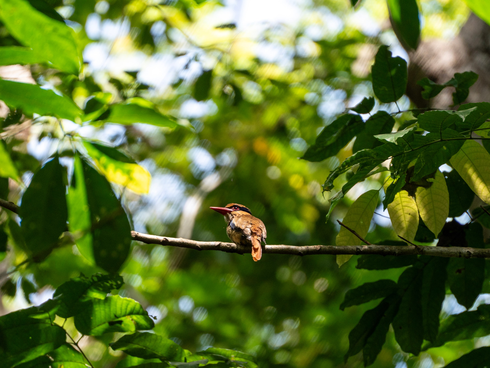
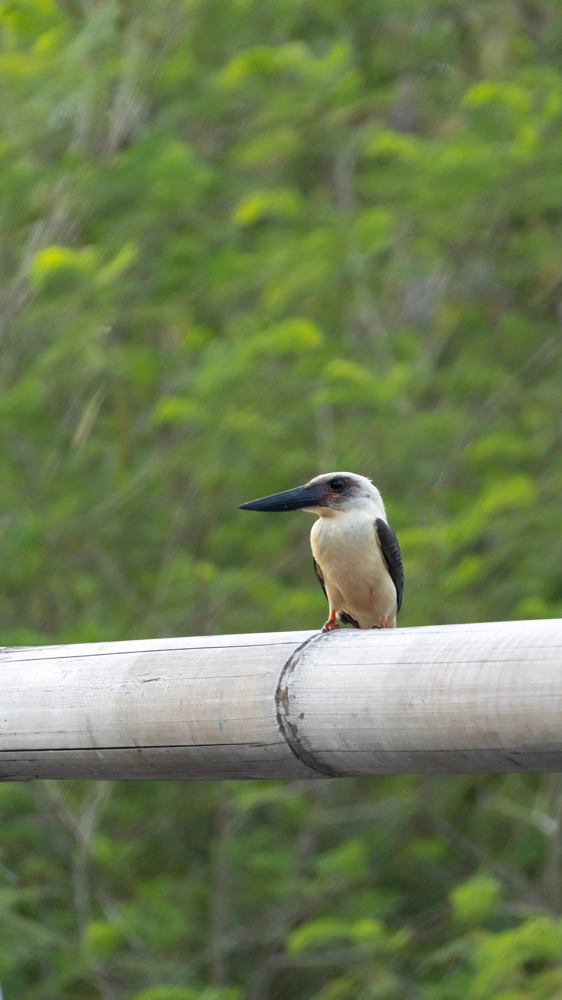
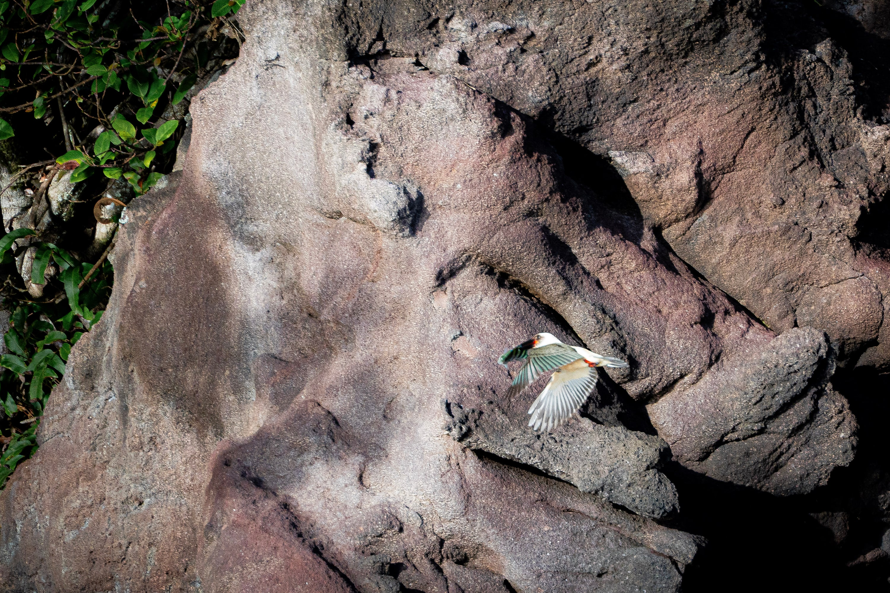
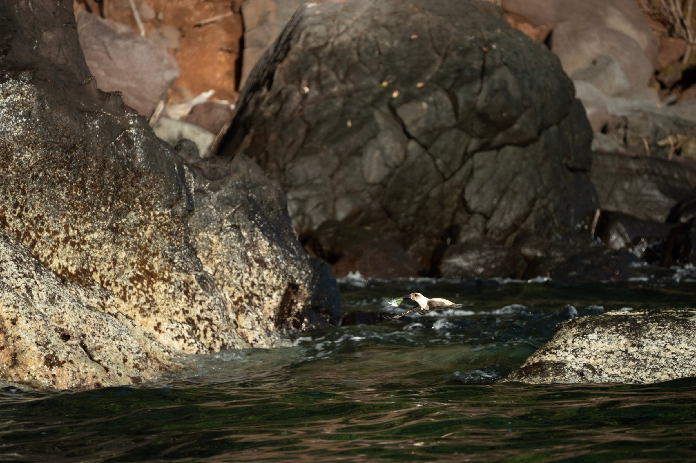
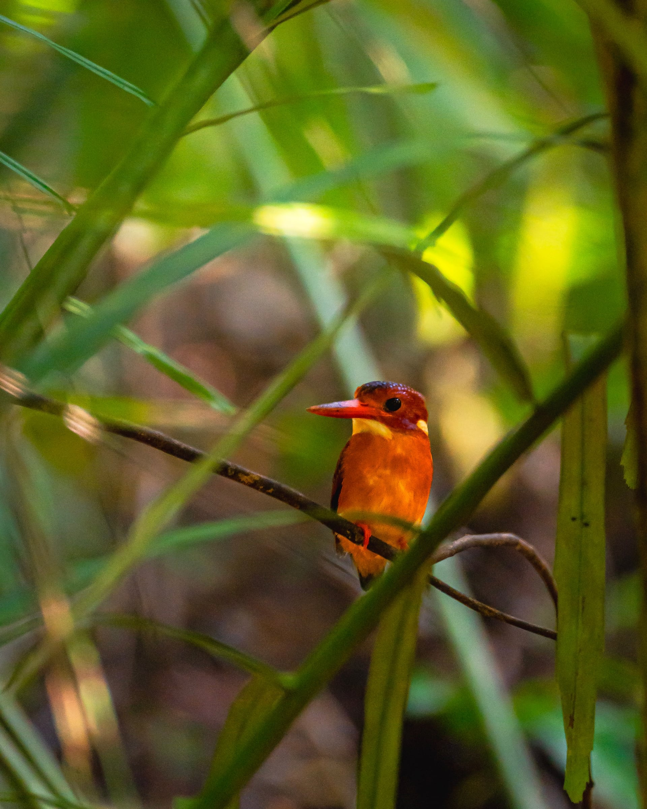

Tangkoko was never really on our list. My partner and I actually went to Manado on a dive trip, and while researching the area we found out about Tangkoko National Park. As a last-minute addition to our trip, we decided to stay at Birding Cottage Tangkoko, a family-run nature lodge. After diving deeper into the research, we realised our 20–70mm lens was not going to cut it. As it just so happened, Tamron was having a sale, so we bought the 70–300mm lens and decided to see what would come of it.

For those unfamiliar, Tangkoko sits on the northern tip of Sulawesi, on the far side of the Wallace Line. That invisible boundary splits the wildlife of Asia from that of Australasia, and Sulawesi falls in between. Many of its animals evolved in isolation, so a large share of the wildlife here is endemic to Sulawesi.

We had two full days there, and they turned into a kingfisher weekend. I photographed four kingfisher species, plus a Knobbed Hornbill. All five are found only in Sulawesi and the islands around it.

## Day 1: The forest floor

On the first day, we took the typical guided route through Tangkoko National Park, where we first encountered the **Green-backed Kingfisher**, and we were in awe. After trekking through the jungle, we found this elusive bird resting on a branch in some amazing dappled light. I had never felt so awed by a wildlife encounter before.

As this was my first time photographing wildlife, there were still a ton of settings I didn't know how to control yet. I'm glad the photos were still in focus, though the high ISO added more noise than I would have liked. Despite all that, I still love this photo, because it was truly the beginning of a passion I didn't realise was growing in me.

Later that morning, a **Lilac Kingfisher** sat on a bare branch long enough for a few frames. This one is also a core memory, because it wasn't our guide who found it: Grace, my partner, spotted the kingfisher perched perfectly on a branch in good light. A perfect way to cap off our morning trek in Tangkoko.

After an incredible day, we asked our host Ardy, a birder himself, what we could do the next day, and he suggested a mangrove tour to look for the **Great-billed Kingfisher**.

## Day 2: The big bill and the tiny one

As we got on the boat to start our second adventure, beginner's luck struck quickly: our boat captain pointed out the kingfisher on the rocks along the shore almost straight away. We were immediately treated to the sight of it diving and hunting. Capturing this was so difficult, as I was still unfamiliar with photographing birds in flight, but these are the pictures I managed to get.

They're not the best photos, but I look back on them fondly as my first photos of birds in flight.

We finished the mangrove tour early and, giddy for more, asked our guide what else we could do in the afternoon. He suggested heading to a different part of the jungle to look for the **Sulawesi Dwarf Kingfisher**.

It was a much tougher trek that required decent fitness and a bit of bush-bashing, but after two hours we caught a glimpse of it perched low in a small bush. A shy and skittish bird, it flew off quickly, but not before I got a picture of it.

After tracking it for 15 minutes or so, satisfied with the encounter, we backed off and let the bird continue on its way without disturbing the area any further.

Overall, it was an incredible trip that let us try many different kinds of birding: from a boat and through the jungle, actively searching and patiently waiting.

## What I'd tell someone going

- **Guide:** a local guide is a must, as most areas are inaccessible without one. Guides also know the bird calls and behaviour, and can help you find what you're looking for.
- **Light:** the forest floor is very dark, so be ready to push your ISO hard, or bring a lens with a wider aperture (a lower f-number).
- **Lens:** everything here was shot on the Tamron 70–300mm, but if you can get a lens with more reach, it will definitely help.
