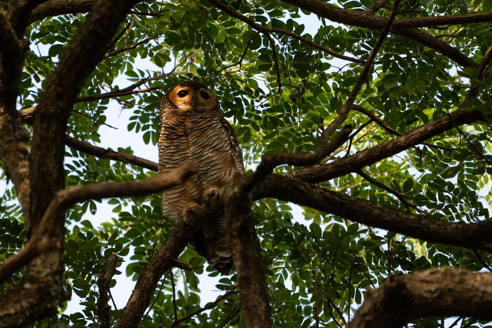
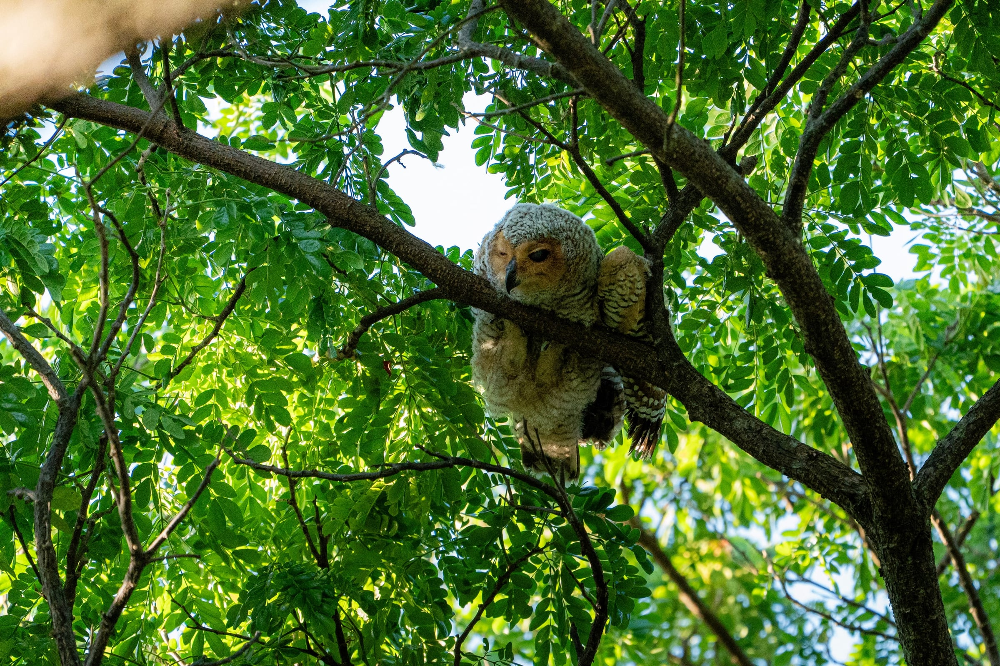

As my interest in birding grew, I made a trip to the mangroves at Pasir Ris Park, where a fellow birder told me that the Spotted Wood Owls had just had a baby and that the fledgling would be easy to find. It turned out to be more difficult than I had anticipated: on my first day there, I couldn't find it at all.

But with persistence, and a little help from the birders I met along the way, I tried again on a weekend, and it turned out I was late. When I got there, a whole crowd of birders had already arrived, filming and photographing the owls as they settled into their resting spots for the day.

The juvenile owl was a little more active than its parents. It stretched its wings and gave us a little show before quickly falling back asleep.

